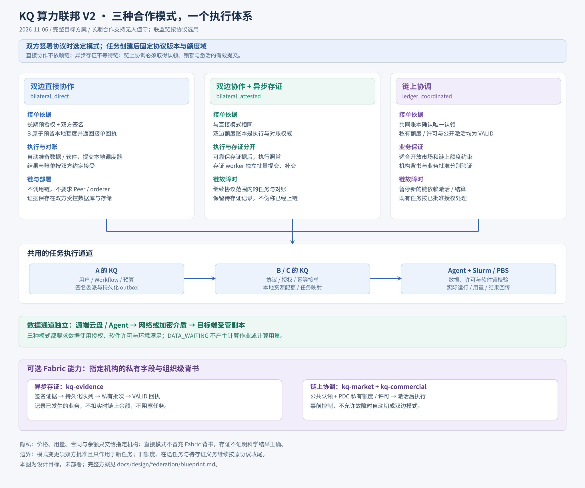

# 算力联邦 V2：设计与实现评审

状态：**实现中，完整联邦功能尚未交付**。设计基于 `main` 提交 `4f359a42dd10e2fc1b355ab76d43fa2b0c74b1d5` 的实际代码分析。当前代码与验证范围见 [实现进展](progress.md)。

目标同时支持三种协议模式：双边直接协作、双边执行后异步上链存证、Fabric 链上协调。直接模式不依赖链；异步存证不进入任务同步执行路径；链上协调保留事前认领和额度门槛。完整交付范围不按实施阶段缩水。

| 文档 | 用途 |
| --- | --- |
| [业务与架构蓝图](blueprint.md) | 三种模式、隐私、长期合作、数据交付、计量与存储治理 |
| [具体实现方案](implementation.md) | 模块边界、数据库约束、协议、执行恢复与部署变更 |
| [可行性与风险评估](assessment.md) | 代码证据、必须修正的假设、工作量性质及残余风险 |
| [完整验收契约](acceptance.md) | 每项保证对应的验证与失败判据 |
| [实现进展与边界](progress.md) | 已完成代码、验证结果与尚未接通的能力 |

评估结论：方向可行，但不属于“加一个链 SDK”的小改动。主要新增工作是可恢复的远端 Workflow、原子接单/额度账本、独立证据存储，以及 Fabric 身份与私有数据边界。现有 Agent、调度器、软件环境和数据副本机制可复用。

## 图纸

- [无人值守与异步存证](assets/kq-federation-v2-unattended.svg)
- [历史归档与 Peer 替换](assets/kq-federation-v2-storage.svg)

此目录区分目标设计与实现进展，不声明当前平台已经具有完整联邦能力。分支已有接单预留、信任管理 API、独立 mTLS 入口及生成的迁移；尚无跨机构作业执行与 Fabric 连接，没有生产部署或生产数据操作。
